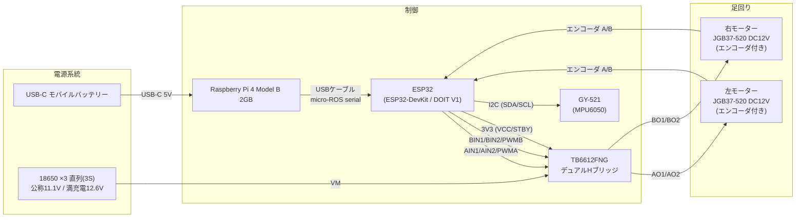

# diegobot 配線設計

自作AMR「diegobot」の電源・信号配線まとめ。実装は `edge/esp32/src/pins.hpp` のピン定義に準拠。

## 1. システム全体構成

## 2. 電源系統

| 系統 | 電源 | 供給先 | 電圧 | 備考 |
|---|---|---|---|---|
| ラズパイ系 | USB-C モバイルバッテリー | Raspberry Pi 4B (2GB) | 5V | 走行中も給電可能なモバイルバッテリーを使用 |
| モーター系 | 18650リチウムイオン電池 ×3（直列3S） | TB6612FNG の VM | 公称11.1V / 満充電12.6V | TB6612FNGのVM許容範囲(2.7〜13.5V)内 |
| ロジック系 | ESP32 の 3V3 | TB6612FNG の VCC・STBY、GY-521、エンコーダ | 3.3V | STBYはGPIO制御せずVCCへ直結、常時イネーブル |

ラズパイ系とモーター系は電源として完全に独立しており、共通GNDはESP32経由（TB6612のGNDとESP32のGNDを接続）でのみ繋がる。

## 3. Raspberry Pi 4B ⟷ ESP32

- 接続: USBケーブル1本（ESP32のmicro-USBポート ⟷ ラズパイのUSB-Aポート）
- 通信: micro-ROS（ESP32ボード上のUSB-UARTブリッジ経由のシリアル、921600baud。ファームの`MICRO_ROS_BAUD`と`micro-ros-agent`の`-b`を揃える）
- Linux側デバイスパス: `/dev/ttyUSB*`。LiDAR(RPLIDAR C1)も同じ `/dev/ttyUSB*` 系で列挙されるため、抜き差しの順序で番号が入れ替わる。`.env` の `HOST_MICRO_ROS_PORT` / `HOST_LIDAR_PORT` を都度確認すること
- ESP32への給電: このUSBケーブル経由のバスパワー（別電源不要）
- 将来、USBを使わずラズパイのGPIO UARTと直結する場合に備え、**GPIO1(TXD0)・GPIO3(RXD0)は他の用途に割り当てず空けてある**

## 4. Raspberry Pi 4B ⟷ カメラ

- カメラモジュール: innomaker CAM-IMX708AF（センサー: IMX708、RGBのみ・深度センサー非搭載）
- 接続: CSIリボンケーブル(15pin-15pin、モジュール同梱品)でラズパイのCAM0ポートへ接続

## 5. ESP32 ピン割当

`edge/esp32/src/pins.hpp` のピン定義準拠。

### TB6612FNG（モーター）

| 役割 | ESP32 GPIO | TB6612FNG |
|---|---|---|
| 左モーター PWM | GPIO25 | PWMA |
| 左モーター 制御1 | GPIO26 | AIN1 |
| 左モーター 制御2 | GPIO27 | AIN2 |
| 右モーター PWM | GPIO14 | PWMB |
| 右モーター 制御1 | GPIO12 | BIN1 |
| 右モーター 制御2 | GPIO13 | BIN2 |
| ロジック電源 | 3V3 | VCC・STBY |
| GND | GND | GND |

PWMはLEDC（左=チャンネル0、右=チャンネル1）、20kHz・8bit(0-255)。

### エンコーダ

| 役割 | ESP32 GPIO |
|---|---|
| 左エンコーダ A相 | GPIO18 |
| 左エンコーダ B相 | GPIO19 |
| 右エンコーダ A相 | GPIO16 |
| 右エンコーダ B相 | GPIO17 |

4ピンとも内部プルアップ有効・エッジ両方(CHANGE)割り込みで4逓倍デコードし、`/odom`・`/joint_states` の元データにする。

### IMU（GY-521 / MPU6050）

| 役割 | ESP32 GPIO |
|---|---|
| I2C SDA | GPIO21 |
| I2C SCL | GPIO22 |
| VCC | 3V3 |

I2Cアドレスは 0x68（AD0=LOW）。

### 使用しない（予約）GPIO

| GPIO | 理由 |
|---|---|
| GPIO1 (TXD0) / GPIO3 (RXD0) | 将来のラズパイとのUART直結用に空けておく |
| GPIO6〜11 | 内蔵フラッシュに接続されており使用不可 |
| GPIO34〜39 | 入力専用（出力・PWM不可） |

## 6. モーター仕様

左右輪とも **JGB37-520 DC12V** ギアードモーター。TB6612FNGのVMは18650×3(3S)由来の公称11.1V/満充電12.6Vのため、モーター定格12Vに対しほぼ整合（フル充電直後は定格をわずかに超えるが実用上問題になりにくい範囲）。

## 7. TB6612FNG ピン配線まとめ

| ピン | 接続先 |
|---|---|
| VM | 18650×3 電池パック（+） |
| VCC | ESP32 3V3 |
| GND | ESP32 GND ・ 電池パック（−）共通 |
| STBY | VCC に直結（常時イネーブル、GPIO制御なし） |
| AIN1 / AIN2 / PWMA | ESP32 GPIO26 / GPIO27 / GPIO25 |
| BIN1 / BIN2 / PWMB | ESP32 GPIO12 / GPIO13 / GPIO14 |
| AO1 / AO2 | 左モーター |
| BO1 / BO2 | 右モーター |

## 8. 既知の制約・注意点

- STBYをVCCへ直結しているため、ESP32側からドライバを無効化する手段が無い。`production/main.hpp` の `AGENT_DISCONNECTED` 時のモーター停止は、STBY遮断ではなくAIN/BIN/PWMを全てLOWにする（ショートブレーキ）方式で実現している。
- モーター用電池パックとラズパイ用USB電源は完全に別系統。GNDはESP32経由でのみ共通化されるため、ESP32未接続の状態でTB6612だけに通電するとロジック側が不定電位になる点に注意。
- USBシリアルのデバイスパス(`/dev/ttyUSB*`)は固定されないため、Docker起動前に実機の番号を確認すること。
- GPIO12はESP32のブートストラップピン（フラッシュ電圧選択）。起動時にHIGHに引かれるとブートに失敗することがあるため、BIN1にはプルアップ等を追加しないこと。
